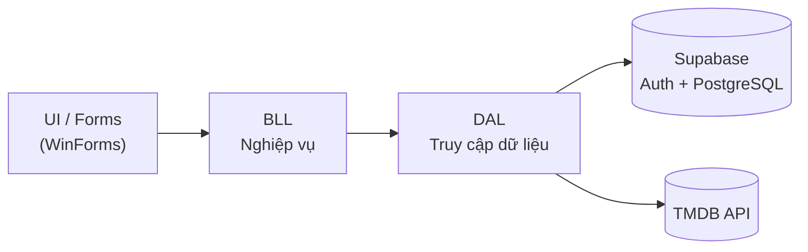

<h1 align="center">Cinema Project</h1>

<p align="center">
  Ứng dụng desktop đặt vé xem phim xây dựng trên <b>.NET 8 WinForms</b> và <b>Supabase</b>.
</p>

<p align="center">
  
  
  
  
  
  
</p>

---

## Mục lục

- [Tổng quan](#tổng-quan)
- [Tính năng](#tính-năng)
- [Kiến trúc](#kiến-trúc)
- [Công nghệ](#công-nghệ)
- [Bắt đầu](#bắt-đầu)
- [Cơ sở dữ liệu](#cơ-sở-dữ-liệu)
- [Cấu trúc dự án](#cấu-trúc-dự-án)
- [Lộ trình](#lộ-trình)
- [Đóng góp](#đóng-góp)
- [Tác giả](#tác-giả)

## Tổng quan

Cinema Project là hệ thống đặt vé xem phim dành cho máy tính Windows. Người dùng có thể đăng ký, đăng nhập, xem phim, chọn suất chiếu và ghế để đặt vé. Quản trị viên quản lý phim, phòng chiếu và theo dõi doanh thu bán vé.

Xác thực và dữ liệu được lưu trên Supabase, thông tin phim được lấy từ TMDB. Mã nguồn tổ chức theo mô hình ba lớp (UI, BLL, DAL) để tách biệt giao diện, nghiệp vụ và truy cập dữ liệu.

## Tính năng

**Người dùng**
- Đăng ký, đăng nhập bằng email và mật khẩu (Supabase Auth)
- Hồ sơ cá nhân tạo tự động khi đăng ký
- Xem danh sách phim, chọn suất chiếu và ghế
- Giá ghế theo loại ghế, hiển thị trạng thái ghế đã đặt

**Quản trị viên**
- Phân quyền hai vai trò `user` và `admin`
- Màn hình quản trị tập trung, mở nhanh quản lý lịch chiếu và báo cáo doanh thu
- Quản lý phim, phòng chiếu, suất chiếu
- Theo dõi giao dịch bán vé (số lượng, đơn giá, tổng tiền, trạng thái thanh toán)

**Kỹ thuật**
- Tích hợp TMDB để lấy dữ liệu phim
- Bảo mật dữ liệu bằng Row Level Security của Supabase
- Ghi log lỗi và sự kiện ra file bằng `Microsoft.Extensions.Logging`

## Kiến trúc



| Lớp | Trách nhiệm |
|---|---|
| **UI / Forms** | Hiển thị giao diện, nhận thao tác người dùng, chỉ gọi BLL |
| **BLL** | Kiểm tra dữ liệu đầu vào, xử lý luật nghiệp vụ, điều phối DAL |
| **DAL** | Giao tiếp với Supabase (Auth, REST) và TMDB, ghi log lỗi kỹ thuật |

## Công nghệ

| Thành phần | Công nghệ |
|---|---|
| Ngôn ngữ, nền tảng | C#, .NET 8 (`net8.0-windows`), Windows Forms |
| Backend | Supabase: Auth, PostgreSQL, PostgREST |
| Nguồn dữ liệu phim | The Movie Database (TMDB) API |
| Logging | Microsoft.Extensions.Logging |

Log từ mức `Information` trở lên được ghi theo ngày vào thư mục `logs` trong thư mục làm việc của dự án, ví dụ `cinema-project\logs\cinema-project-yyyyMMdd.log`.

### Debug trong VS Code

Chọn cấu hình **Cinema Project (.NET)** trong tab **Run and Debug** rồi nhấn **F5**. Debugger dừng tại entry point trước khi chạy `Main`; sau đó có thể đặt breakpoint dòng bằng **F9**. Các điểm dừng được quản lý bởi debugger, không chèn `Debugger.Break()` vào luồng chạy của ứng dụng.

## Bắt đầu

### Yêu cầu

- Windows 10 trở lên
- [.NET 8 SDK](https://dotnet.microsoft.com/download/dotnet/8.0)
- Visual Studio 2022 với workload **.NET desktop development**
- Tài khoản [Supabase](https://supabase.com) và [TMDB](https://www.themoviedb.org)

### Cài đặt

```bash
git clone https://github.com/tuanaynh2212/Cinema-Project.git
cd Cinema-Project
dotnet restore
```

### Cấu hình

| Thông số | Nơi lấy | Nơi điền |
|---|---|---|
| `SupabaseUrl` | Supabase → Project Settings → API → Project URL | `SupabaseService` |
| `SupabaseKey` | Supabase → Project Settings → API → `anon` key | `SupabaseService` |
| TMDB API key | TMDB → Settings → API | Service TMDB |

> **Lưu ý bảo mật:** chỉ dùng `anon` key trong ứng dụng desktop, không dùng `service_role` key. Không commit khóa lên repository.

### Chạy ứng dụng

```bash
dotnet run
```

Hoặc mở `cinema-project.csproj` trong Visual Studio và nhấn **F5**.

## Cơ sở dữ liệu

| Bảng | Mô tả |
|---|---|
| `profiles` | Hồ sơ người dùng: họ tên, số điện thoại, ngày sinh, vai trò, điểm. Tự tạo bằng trigger khi đăng ký |
| `movies` | Danh sách phim |
| `phong_chieu` | Phòng chiếu |
| `ghe_suat_chieu` | Ghế theo từng suất chiếu: mã ghế, giá ghế, trạng thái, ngày đặt |
| `ticket_sales` | Giao dịch bán vé: số lượng, đơn giá, tổng tiền, trạng thái thanh toán |

Truy cập dữ liệu được kiểm soát bằng Row Level Security: mỗi người dùng chỉ đọc và sửa được hồ sơ của mình, các cột nhạy cảm như `role` và `points` không thể tự thay đổi từ client.

## Cấu trúc dự án

```text
Cinema-Project/
├── BLL/                    Lớp nghiệp vụ
├── DAL/                    Lớp truy cập dữ liệu (Supabase, TMDB)
│   ├── DTO/                Các model trao đổi dữ liệu
│   └── PhienDangNhap.cs    Trạng thái phiên đăng nhập
├── UI/
│   └── Forms/              Các form giao diện
├── Program.cs              Điểm khởi chạy
└── cinema-project.csproj
```

## Lộ trình

- [x] Đăng ký, đăng nhập với Supabase Auth
- [x] Hồ sơ người dùng và phân quyền `user` / `admin`
- [x] Tích hợp TMDB
- [x] Logging cho tầng DAL
- [x] Gắn `user_id` cho vé đã đặt
- [x] Màn hình lịch sử vé của người dùng
- [ ] Làm mới token khi phiên đăng nhập hết hạn
- [ ] Trang quản trị và báo cáo doanh thu
- [ ] Unit test cho BLL

## Đóng góp

1. Fork repository và tạo nhánh mới: `git checkout -b feature/ten-tinh-nang`
2. Commit thay đổi: `git commit -m "feat: mô tả ngắn gọn"`
3. Push nhánh và mở Pull Request

Quy ước commit: `feat`, `fix`, `refactor`, `docs`, `test`.

## Tác giả

**tuanaynh2212** · [github.com/tuanaynh2212](https://github.com/tuanaynh2212)
